# ROYAL DESIGN — معرض الأيقونات الخاص

**المستودع يبقى خاصاً.** هذا الملف يعرض الصور داخل GitHub، والمعرض التفاعلي يحتوي على البحث واختيار التطبيق والنسختين 2D و3D.

- **[افتح المعرض التفاعلي](../preview/royal-design/index.html)**
- **[الفهرس الآلي الموحد](../icons/app-collections.json)**

## مجموعات التطبيقات الجديدة V10–V14

### V10 — الملكي / Almalaki

| المفهوم | 2D | 3D | مفتاح الاستخدام |
|---|---|---|---|
| **قهوة** |  |  | `coffee` |
| **المطعم** |  | [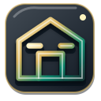](../icons/v10/almalaki/3d/restaurant.svg) | `restaurant` |
| **قائمة الطعام** | [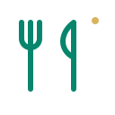](../icons/v10/almalaki/2d/menu.svg) | [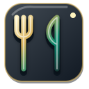](../icons/v10/almalaki/3d/menu.svg) | `menu` |
| **سلة التسوق** |  |  | `cart` |
| **الطلبات** |  |  | `order` |
| **الطاولات والحجوزات** | [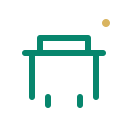](../icons/v10/almalaki/2d/table.svg) |  | `table` |
| **التوصيل** |  |  | `delivery` |
| **الدفع** | [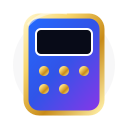](../icons/v10/almalaki/2d/payment.svg) | [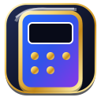](../icons/v10/almalaki/3d/payment.svg) | `payment` |

### V11 — ROYAL TV

| المفهوم | 2D | 3D | مفتاح الاستخدام |
|---|---|---|---|
| **التلفاز** |  |  | `television` |
| **بث مباشر** |  | [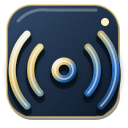](../icons/v11/royal-tv/3d/live.svg) | `live` |
| **القنوات** |  | [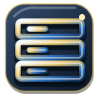](../icons/v11/royal-tv/3d/channels.svg) | `channels` |
| **جهاز التحكم** |  | [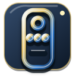](../icons/v11/royal-tv/3d/remote.svg) | `remote` |
| **دليل البرامج** |  |  | `guide` |
| **المفضلة** |  |  | `favorite` |
| **بث إلى الشاشة** |  |  | `cast` |
| **الترجمة النصية** |  |  | `subtitles` |

### V12 — ROYAL+ Launcher

| المفهوم | 2D | 3D | مفتاح الاستخدام |
|---|---|---|---|
| **التطبيقات** | [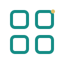](../icons/v12/royal-plus/2d/apps.svg) | [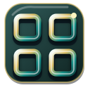](../icons/v12/royal-plus/3d/apps.svg) | `apps` |
| **الطقس المشمس** |  | [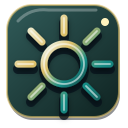](../icons/v12/royal-plus/3d/weather.svg) | `weather` |
| **المطر** | [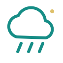](../icons/v12/royal-plus/2d/rain.svg) | [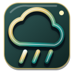](../icons/v12/royal-plus/3d/rain.svg) | `rain` |
| **المدفأة** |  | [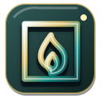](../icons/v12/royal-plus/3d/fireplace.svg) | `fireplace` |
| **أصوات الطيور** |  |  | `birds` |
| **القرآن الكريم** |  |  | `quran` |
| **مواقيت الصلاة** | [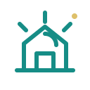](../icons/v12/royal-plus/2d/prayer.svg) | [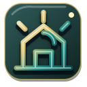](../icons/v12/royal-plus/3d/prayer.svg) | `prayer` |
| **الخلفيات** |  | [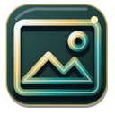](../icons/v12/royal-plus/3d/wallpaper.svg) | `wallpaper` |

### V13 — RS TV / Sinjar

| المفهوم | 2D | 3D | مفتاح الاستخدام |
|---|---|---|---|
| **قائمة القنوات** | [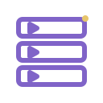](../icons/v13/rs-tv/2d/channel-list.svg) | [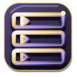](../icons/v13/rs-tv/3d/channel-list.svg) | `channel-list` |
| **بث الفيديو** |  | [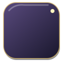](../icons/v13/rs-tv/3d/stream.svg) | `stream` |
| **مشغل الفيديو** |  |  | `player` |
| **ملء الشاشة** |  |  | `fullscreen` |
| **الترجمة** |  |  | `subtitles` |
| **مسار الصوت** |  |  | `audio` |
| **مصدر البث** |  |  | `source` |
| **تحديث القائمة** |  |  | `refresh` |

### V14 — RAMI Developer

| المفهوم | 2D | 3D | مفتاح الاستخدام |
|---|---|---|---|
| **لوحة المطور** |  |  | `dashboard` |
| **المشاريع** |  |  | `projects` |
| **البناء** |  |  | `build` |
| **الإصدار** |  | [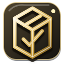](../icons/v14/rami-developer/3d/release.svg) | `release` |
| **مفتاح التوقيع** |  |  | `signing-key` |
| **رمز المالك** |  |  | `owner-code` |
| **سجل التنفيذ** |  |  | `terminal` |
| **قاعدة البيانات** |  |  | `database` |

## الحقوق والمنشأ

الأيقونات الجديدة أصلية ومؤلفة خصيصاً لـROYAL Design. كل ملف يحمل بيان منشأ `original_royal` وترخيص `ROYAL_ORIGINAL`. لا تحتوي المجموعات على أعمال IconScout أو شعارات تجارية منسوخة أو مسارات متتبعة.

## المكتبة التاريخية

تظل أيقونات V2–V9 الـ162، بما فيها حركة V9، محفوظة في [الفهرس القديم](../icons/README.md). كما بقيت مجموعة V10 المصدرية القديمة ومجموعة V13 العامة السابقة دون حذف، إلى جانب مجموعات التطبيقات الجديدة.
