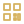
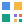
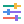
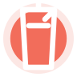
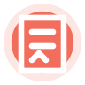

# ROYAL DESIGN — معرض الأيقونات الخاص

كل أيقونة تظهر داخل بطاقة مستقلة: **الصورة أولًا، ثم اسمها تحتها**. اضغط على الصورة لفتح ملف SVG الأصلي، واستخدم مفتاح الاستخدام أو اسم مورد Android أسفلها عند إضافتها إلى التطبيق.

**162 أيقونة** · **37 أيقونة متحركة** · المستودع خاص.

## تحديث الإصدارات V10–V14

- **[فتح المعرض التفاعلي](../preview/v9-icon-catalog/index.html)** — صفحة HTML قابلة للفتح محلياً من الهاتف، مع البحث والتصفية ونسخ المعرّفات.
- **V10:** 12 ملف SVG مستورداً من مصادر V2–V9؛ هذه نسخ مصدرية وليست بعد إعادة تصميم Flat وGlass.
- **V11:** لم تُضف ملفات 3D PNG إلى `main` بعد.
- **V12:** لم تُضف ملفات الحركة المستقلة إلى `main` بعد.
- **V13:** 8 مفاهيم أصلية بنسختَي Flat وGlass (16 SVG)، بانتظار المراجعة البصرية.
- **V14:** لم تُضف أصول 3D الأصلية إلى `main` بعد.

لا تُعرض الإصدارات التي لا تملك ملفات فعلية كأيقونات جاهزة، ولا يُعدّ وجود الخطة اعتماداً فنياً.

## اختر الإصدار

[V10 — ملفات مصدر 2D (12)](../preview/v9-icon-catalog/index.html#v10)　·　[V13 — 2D أصلي (16 ملفاً)](../preview/v9-icon-catalog/index.html#v13)

[V2 — الأيقونات الأساسية (22)](#v2)　·　[V3 — أساسيات ROYAL (10)](#v3)　·　[V4 — لوحة المطور والإدارة (12)](#v4)　·　[V5 — المال والتسوق (20)](#v5)　·　[V6 — التسوق الملون (12)](#v6)　·　[V7 — التحكم والوسائط (26)](#v7)　·　[V8 — مشغل الوسائط وشارات المنتجات (23)](#v8)　·　[V9 — المقاهي والمطاعم والطلبات (37)](#v9)

## V2 — الأيقونات الأساسية

|  **حساب المستخدم** <small>`royal_account_circle`</small> <small>Android: `royal_account_circle`</small> |  **جهاز أندرويد** <small>`royal_android_device`</small> <small>Android: `royal_android_device`</small> |  **التطبيقات** <small>`royal_apps`</small> <small>Android: `royal_apps`</small> |  **سهم رجوع** <small>`royal_arrow_back`</small> <small>Android: `royal_arrow_back`</small> |
|:---:|:---:|:---:|:---:|
|  **سهم للأمام** <small>`royal_arrow_forward`</small> <small>Android: `royal_arrow_forward`</small> |  **البطارية ممتلئة** <small>`royal_battery_full`</small> <small>Android: `royal_battery_full`</small> |  **بلوتوث** <small>`royal_bluetooth`</small> <small>Android: `royal_bluetooth`</small> |  **بث الشاشة** <small>`royal_cast`</small> <small>Android: `royal_cast`</small> |
|:---:|:---:|:---:|:---:|
|  **تنزيل** <small>`royal_download`</small> <small>Android: `royal_download`</small> |  **مجلد** <small>`royal_folder`</small> <small>Android: `royal_folder`</small> |  **مساعدة** <small>`royal_help`</small> <small>Android: `royal_help`</small> |  **معلومات** <small>`royal_info`</small> <small>Android: `royal_info`</small> |
|:---:|:---:|:---:|:---:|
|  **لوحة المفاتيح** <small>`royal_keyboard`</small> <small>Android: `royal_keyboard`</small> |  **القائمة** <small>`royal_menu`</small> <small>Android: `royal_menu`</small> |  **المزيد** <small>`royal_more_vert`</small> <small>Android: `royal_more_vert`</small> |  **الإشعارات** <small>`royal_notifications_active`</small> <small>Android: `royal_notifications_active`</small> |
|:---:|:---:|:---:|:---:|
|  **رمز QR** <small>`royal_qr_code`</small> <small>Android: `royal_qr_code`</small> |  **تحديث** <small>`royal_refresh`</small> <small>Android: `royal_refresh`</small> |  **مشاركة الشاشة** <small>`royal_screen_share`</small> <small>Android: `royal_screen_share`</small> |  **ضبط** <small>`royal_tune`</small> <small>Android: `royal_tune`</small> |
|:---:|:---:|:---:|:---:|
|  **تحذير** <small>`royal_warning`</small> <small>Android: `royal_warning`</small> |  **واي فاي** <small>`royal_wifi`</small> <small>Android: `royal_wifi`</small> |
|:---:|:---:|

## V3 — أساسيات ROYAL

|  **شبكة التطبيقات** <small>`royal_apps_grid`</small> <small>Android: `royal_apps_grid`</small> |  **بث الشاشة** <small>`royal_cast`</small> <small>Android: `royal_cast`</small> |  **مزامنة سحابية** <small>`royal_cloud_sync`</small> <small>Android: `royal_cloud_sync`</small> |  **قهوة** <small>`royal_coffee`</small> <small>Android: `royal_coffee`</small> |
|:---:|:---:|:---:|:---:|
|  **لوحة التحكم** <small>`royal_dashboard`</small> <small>Android: `royal_dashboard`</small> |  **وضع المطور** <small>`royal_developer_mode`</small> <small>Android: `royal_developer_mode`</small> |  **المدفوعات** <small>`royal_payments`</small> <small>Android: `royal_payments`</small> |  **الأمان** <small>`royal_security`</small> <small>Android: `royal_security`</small> |
|:---:|:---:|:---:|:---:|
|  **تلفاز ذكي** <small>`royal_smart_tv`</small> <small>Android: `royal_smart_tv`</small> |  **واي فاي** <small>`royal_wifi`</small> <small>Android: `royal_wifi`</small> |
|:---:|:---:|

## V4 — لوحة المطور والإدارة

|  **الرئيسية ولوحة التحكم** <small>`01_home_dashboard`</small> <small>Android: `royal_home_dashboard`</small> |  **المشاريع** <small>`02_projects`</small> <small>Android: `royal_projects`</small> |  **البناء** <small>`03_build`</small> <small>Android: `royal_build`</small> |  **الحساب** <small>`04_account`</small> <small>Android: `royal_account`</small> |
|:---:|:---:|:---:|:---:|
|  **مفتاح المالك** <small>`05_owner_key`</small> <small>Android: `royal_owner_key`</small> |  **سجل الرموز** <small>`06_code_history`</small> <small>Android: `royal_code_history`</small> |  **الإعدادات** <small>`07_settings`</small> <small>Android: `royal_settings`</small> |  **الأمان** <small>`08_security`</small> <small>Android: `royal_security`</small> |
|:---:|:---:|:---:|:---:|
|  **الأمان الزمردي** <small>`08_security_emerald`</small> <small>Android: `royal_security_emerald`</small> |  **المزامنة** <small>`09_sync`</small> <small>Android: `royal_sync`</small> |  **المزامنة الزمردية** <small>`09_sync_emerald`</small> <small>Android: `royal_sync_emerald`</small> |  **الإصدارات** <small>`10_releases`</small> <small>Android: `royal_releases`</small> |
|:---:|:---:|:---:|:---:|

## V5 — المال والتسوق

|  **ورقة نقدية** <small>`royal_banknote`</small> <small>Android: `royal_banknote`</small> |  **سلة** <small>`royal_basket`</small> <small>Android: `royal_basket`</small> |  **آلة حاسبة** <small>`royal_calculator`</small> <small>Android: `royal_calculator`</small> |  **عربة التسوق** <small>`royal_cart`</small> <small>Android: `royal_cart`</small> |
|:---:|:---:|:---:|:---:|
|  **صندوق الدفع** <small>`royal_cash_register`</small> <small>Android: `royal_cash_register`</small> |  **تقليل** <small>`royal_circle_minus`</small> <small>Android: `royal_circle_minus`</small> |  **إضافة** <small>`royal_circle_plus`</small> <small>Android: `royal_circle_plus`</small> |  **عملة** <small>`royal_coin`</small> <small>Android: `royal_coin`</small> |
|:---:|:---:|:---:|:---:|
|  **بطاقة ائتمان** <small>`royal_credit_card`</small> <small>Android: `royal_credit_card`</small> |  **خصم** <small>`royal_discount`</small> <small>Android: `royal_discount`</small> |  **نقود باليد** <small>`royal_hand_coins`</small> <small>Android: `royal_hand_coins`</small> |  **ناقص** <small>`royal_minus`</small> <small>Android: `royal_minus`</small> |
|:---:|:---:|:---:|:---:|
|  **تأكيد الطلب** <small>`royal_order_check`</small> <small>Android: `royal_order_check`</small> |  **جهاز الدفع** <small>`royal_payment_terminal`</small> <small>Android: `royal_payment_terminal`</small> |  **زائد** <small>`royal_plus`</small> <small>Android: `royal_plus`</small> |  **إيصال** <small>`royal_receipt`</small> <small>Android: `royal_receipt`</small> |
|:---:|:---:|:---:|:---:|
|  **حقيبة تسوق** <small>`royal_shopping_bag`</small> <small>Android: `royal_shopping_bag`</small> |  **بطاقة سعر** <small>`royal_tag`</small> <small>Android: `royal_tag`</small> |  **تحويل** <small>`royal_transfer`</small> <small>Android: `royal_transfer`</small> |  **محفظة** <small>`royal_wallet`</small> <small>Android: `royal_wallet`</small> |
|:---:|:---:|:---:|:---:|

## V6 — التسوق الملون

|  **بنك** <small>`royal_bank`</small> <small>Android: `royal_bank`</small> |  **باركود** <small>`royal_barcode`</small> <small>Android: `royal_barcode`</small> |  **قسيمة** <small>`royal_coupon`</small> <small>Android: `royal_coupon`</small> |  **شاحنة توصيل** <small>`royal_delivery_truck`</small> <small>Android: `royal_delivery_truck`</small> |
|:---:|:---:|:---:|:---:|
|  **هدية** <small>`royal_gift_box`</small> <small>Android: `royal_gift_box`</small> |  **نجمة الولاء** <small>`royal_loyalty_star`</small> <small>Android: `royal_loyalty_star`</small> |  **طرد** <small>`royal_package`</small> <small>Android: `royal_package`</small> |  **دفع QR** <small>`royal_qr_payment`</small> <small>Android: `royal_qr_payment`</small> |
|:---:|:---:|:---:|:---:|
|  **إرجاع** <small>`royal_return`</small> <small>Android: `royal_return`</small> |  **خزنة** <small>`royal_safe`</small> <small>Android: `royal_safe`</small> |  **متجر** <small>`royal_store`</small> <small>Android: `royal_store`</small> |  **قائمة الرغبات** <small>`royal_wishlist`</small> <small>Android: `royal_wishlist`</small> |
|:---:|:---:|:---:|:---:|

## V7 — التحكم والوسائط

|  **سهم رجوع** <small>`royal_arrow_back`</small> <small>Android: `royal_arrow_back`</small> |  **سهم للأسفل** <small>`royal_arrow_down`</small> <small>Android: `royal_arrow_down`</small> |  **سهم للأمام** <small>`royal_arrow_forward`</small> <small>Android: `royal_arrow_forward`</small> |  **سهم لليسار** <small>`royal_arrow_left`</small> <small>Android: `royal_arrow_left`</small> |
|:---:|:---:|:---:|:---:|
|  **سهم لليمين** <small>`royal_arrow_right`</small> <small>Android: `royal_arrow_right`</small> |  **سهم للأعلى** <small>`royal_arrow_up`</small> <small>Android: `royal_arrow_up`</small> |  **رجوع** <small>`royal_back`</small> <small>Android: `royal_back`</small> |  **إغلاق** <small>`royal_close`</small> <small>Android: `royal_close`</small> |
|:---:|:---:|:---:|:---:|
|  **سماعات** <small>`royal_headphones`</small> <small>Android: `royal_headphones`</small> |  **القائمة** <small>`royal_menu`</small> <small>Android: `royal_menu`</small> |  **نغمة موسيقية** <small>`royal_music_note`</small> <small>Android: `royal_music_note`</small> |  **نغمات موسيقية** <small>`royal_music_notes`</small> <small>Android: `royal_music_notes`</small> |
|:---:|:---:|:---:|:---:|
|  **فتح في نافذة** <small>`royal_open_in_new`</small> <small>Android: `royal_open_in_new`</small> |  **إيقاف مؤقت** <small>`royal_pause`</small> <small>Android: `royal_pause`</small> |  **تشغيل** <small>`royal_play`</small> <small>Android: `royal_play`</small> |  **قائمة تشغيل** <small>`royal_playlist`</small> <small>Android: `royal_playlist`</small> |
|:---:|:---:|:---:|:---:|
|  **بحث** <small>`royal_search`</small> <small>Android: `royal_search`</small> |  **بحث موسع** <small>`royal_search_plus`</small> <small>Android: `royal_search_plus`</small> |  **الإعدادات** <small>`royal_settings`</small> <small>Android: `royal_settings`</small> |  **التالي** <small>`royal_skip_next`</small> <small>Android: `royal_skip_next`</small> |
|:---:|:---:|:---:|:---:|
|  **السابق** <small>`royal_skip_previous`</small> <small>Android: `royal_skip_previous`</small> |  **خطوات** <small>`royal_steps`</small> <small>Android: `royal_steps`</small> |  **ضبط** <small>`royal_tune`</small> <small>Android: `royal_tune`</small> |  **رفع الصوت** <small>`royal_volume_up`</small> <small>Android: `royal_volume_up`</small> |
|:---:|:---:|:---:|:---:|
|  **نافذة** <small>`royal_window`</small> <small>Android: `royal_window`</small> |  **فتح النافذة** <small>`royal_window_open`</small> <small>Android: `royal_window_open`</small> |
|:---:|:---:|

## V8 — مشغل الوسائط وشارات المنتجات

|  **الأكثر مبيعاً** <small>`royal_badge_bestseller`</small> <small>Android: `royal_badge_bestseller`</small> |  **شارة تخفيض** <small>`royal_badge_discount`</small> <small>Android: `royal_badge_discount`</small> |  **مميز** <small>`royal_badge_featured`</small> <small>Android: `royal_badge_featured`</small> |  **هدية** <small>`royal_badge_gift`</small> <small>Android: `royal_badge_gift`</small> |
|:---:|:---:|:---:|:---:|
|  **كمية محدودة** <small>`royal_badge_limited`</small> <small>Android: `royal_badge_limited`</small> |  **جديد** <small>`royal_badge_new`</small> <small>Android: `royal_badge_new`</small> |  **بريميوم** <small>`royal_badge_premium`</small> <small>Android: `royal_badge_premium`</small> |  **تخفيضات** <small>`royal_badge_sale`</small> <small>Android: `royal_badge_sale`</small> |
|:---:|:---:|:---:|:---:|
|  **عرض خاص** <small>`royal_badge_special_offer`</small> <small>Android: `royal_badge_special_offer`</small> |  **رائج** <small>`royal_badge_trending`</small> <small>Android: `royal_badge_trending`</small> |  **بث** <small>`royal_media_cast`</small> <small>Android: `royal_media_cast`</small> |  **موازن الصوت** <small>`royal_media_equalizer`</small> <small>Android: `royal_media_equalizer`</small> |
|:---:|:---:|:---:|:---:|
|  **ملء الشاشة** <small>`royal_media_fullscreen`</small> <small>Android: `royal_media_fullscreen`</small> |  **التالي** <small>`royal_media_next`</small> <small>Android: `royal_media_next`</small> |  **صورة داخل صورة** <small>`royal_media_picture_in_picture`</small> <small>Android: `royal_media_picture_in_picture`</small> |  **السابق** <small>`royal_media_previous`</small> <small>Android: `royal_media_previous`</small> |
|:---:|:---:|:---:|:---:|
|  **تكرار** <small>`royal_media_repeat`</small> <small>Android: `royal_media_repeat`</small> |  **إعادة** <small>`royal_media_replay`</small> <small>Android: `royal_media_replay`</small> |  **خلط** <small>`royal_media_shuffle`</small> <small>Android: `royal_media_shuffle`</small> |  **السرعة** <small>`royal_media_speed`</small> <small>Android: `royal_media_speed`</small> |
|:---:|:---:|:---:|:---:|
|  **إيقاف** <small>`royal_media_stop`</small> <small>Android: `royal_media_stop`</small> |  **ترجمة نصية** <small>`royal_media_subtitles`</small> <small>Android: `royal_media_subtitles`</small> |  **فيديو** <small>`royal_media_video`</small> <small>Android: `royal_media_video`</small> |
|:---:|:---:|:---:|

## V9 — المقاهي والمطاعم والطلبات

|  **إلغاء الحجز** <small>`royal_booking_cancelled`</small> <small>Android: `royal_booking_cancelled`</small> [نسخة متحركة](../icons/v9/cafe-orders/motion/svg/royal_booking_cancelled_animated.svg) |  **حجز مؤكد** <small>`royal_booking_confirmed`</small> <small>Android: `royal_booking_confirmed`</small> [نسخة متحركة](../icons/v9/cafe-orders/motion/svg/royal_booking_confirmed_animated.svg) |  **حجز جديد** <small>`royal_booking_new`</small> <small>Android: `royal_booking_new`</small> [نسخة متحركة](../icons/v9/cafe-orders/motion/svg/royal_booking_new_animated.svg) |  **طاولة متاحة** <small>`royal_booking_table_available`</small> <small>Android: `royal_booking_table_available`</small> [نسخة متحركة](../icons/v9/cafe-orders/motion/svg/royal_booking_table_available_animated.svg) |
|:---:|:---:|:---:|:---:|
|  **طاولة مشغولة** <small>`royal_booking_table_occupied`</small> <small>Android: `royal_booking_table_occupied`</small> [نسخة متحركة](../icons/v9/cafe-orders/motion/svg/royal_booking_table_occupied_animated.svg) |  **حجز منتظر** <small>`royal_booking_waiting`</small> <small>Android: `royal_booking_waiting`</small> [نسخة متحركة](../icons/v9/cafe-orders/motion/svg/royal_booking_waiting_animated.svg) |  **قهوة** <small>`royal_coffee`</small> <small>Android: `royal_food_coffee`</small> [نسخة متحركة](../icons/v9/cafe-orders/motion/svg/royal_coffee_animated.svg) |  **خرج للتوصيل** <small>`royal_delivery_out`</small> <small>Android: `royal_delivery_out`</small> [نسخة متحركة](../icons/v9/cafe-orders/motion/svg/royal_delivery_out_animated.svg) |
|:---:|:---:|:---:|:---:|
|  **التوصيل جارٍ** <small>`royal_delivery_progress`</small> <small>Android: `royal_delivery_progress`</small> [نسخة متحركة](../icons/v9/cafe-orders/motion/svg/royal_delivery_progress_animated.svg) |  **برغر** <small>`royal_food_burger`</small> <small>Android: `royal_food_burger`</small> [نسخة متحركة](../icons/v9/cafe-orders/motion/svg/royal_food_burger_animated.svg) |  **حلويات** <small>`royal_food_dessert`</small> <small>Android: `royal_food_dessert`</small> [نسخة متحركة](../icons/v9/cafe-orders/motion/svg/royal_food_dessert_animated.svg) |  **مثلجات** <small>`royal_food_ice_cream`</small> <small>Android: `royal_food_ice_cream`</small> [نسخة متحركة](../icons/v9/cafe-orders/motion/svg/royal_food_ice_cream_animated.svg) |
|:---:|:---:|:---:|:---:|
|  **بيتزا** <small>`royal_food_pizza`</small> <small>Android: `royal_food_pizza`</small> [نسخة متحركة](../icons/v9/cafe-orders/motion/svg/royal_food_pizza_animated.svg) |  **سلطة** <small>`royal_food_salad`</small> <small>Android: `royal_food_salad`</small> [نسخة متحركة](../icons/v9/cafe-orders/motion/svg/royal_food_salad_animated.svg) |  **ساندويتش** <small>`royal_food_sandwich`</small> <small>Android: `royal_food_sandwich`</small> [نسخة متحركة](../icons/v9/cafe-orders/motion/svg/royal_food_sandwich_animated.svg) |  **شاورما** <small>`royal_food_shawarma`</small> <small>Android: `royal_food_shawarma`</small> [نسخة متحركة](../icons/v9/cafe-orders/motion/svg/royal_food_shawarma_animated.svg) |
|:---:|:---:|:---:|:---:|
|  **شاي** <small>`royal_food_tea`</small> <small>Android: `royal_food_tea`</small> [نسخة متحركة](../icons/v9/cafe-orders/motion/svg/royal_food_tea_animated.svg) |  **عصير** <small>`royal_juice`</small> <small>Android: `royal_juice`</small> [نسخة متحركة](../icons/v9/cafe-orders/motion/svg/royal_juice_animated.svg) |  **طلب مقبول** <small>`royal_order_accepted`</small> <small>Android: `royal_order_accepted`</small> [نسخة متحركة](../icons/v9/cafe-orders/motion/svg/royal_order_accepted_animated.svg) |  **طلب ملغى** <small>`royal_order_cancelled`</small> <small>Android: `royal_order_cancelled`</small> [نسخة متحركة](../icons/v9/cafe-orders/motion/svg/royal_order_cancelled_animated.svg) |
|:---:|:---:|:---:|:---:|
|  **إلغاء من الزبون** <small>`royal_order_cancelled_customer`</small> <small>Android: `royal_order_cancelled_customer`</small> [نسخة متحركة](../icons/v9/cafe-orders/motion/svg/royal_order_cancelled_customer_animated.svg) |  **إلغاء من المطعم** <small>`royal_order_cancelled_restaurant`</small> <small>Android: `royal_order_cancelled_restaurant`</small> [نسخة متحركة](../icons/v9/cafe-orders/motion/svg/royal_order_cancelled_restaurant_animated.svg) |  **طلب مؤكد** <small>`royal_order_confirmed`</small> <small>Android: `royal_order_confirmed`</small> [نسخة متحركة](../icons/v9/cafe-orders/motion/svg/royal_order_confirmed_animated.svg) |  **تم التسليم** <small>`royal_order_delivered`</small> <small>Android: `royal_order_delivered`</small> [نسخة متحركة](../icons/v9/cafe-orders/motion/svg/royal_order_delivered_animated.svg) |
|:---:|:---:|:---:|:---:|
|  **طلب قيد التنفيذ** <small>`royal_order_in_progress`</small> <small>Android: `royal_order_in_progress`</small> [نسخة متحركة](../icons/v9/cafe-orders/motion/svg/royal_order_in_progress_animated.svg) |  **طلب جديد** <small>`royal_order_new`</small> <small>Android: `royal_order_new`</small> [نسخة متحركة](../icons/v9/cafe-orders/motion/svg/royal_order_new_animated.svg) |  **استلام الطلب** <small>`royal_order_pickup`</small> <small>Android: `royal_order_pickup`</small> [نسخة متحركة](../icons/v9/cafe-orders/motion/svg/royal_order_pickup_animated.svg) |  **جاري التحضير** <small>`royal_order_preparing`</small> <small>Android: `royal_order_preparing`</small> [نسخة متحركة](../icons/v9/cafe-orders/motion/svg/royal_order_preparing_animated.svg) |
|:---:|:---:|:---:|:---:|
|  **الطلب جاهز** <small>`royal_order_ready`</small> <small>Android: `royal_order_ready`</small> [نسخة متحركة](../icons/v9/cafe-orders/motion/svg/royal_order_ready_animated.svg) |  **إعادة الطلب** <small>`royal_order_reorder`</small> <small>Android: `royal_order_reorder`</small> [نسخة متحركة](../icons/v9/cafe-orders/motion/svg/royal_order_reorder_animated.svg) |  **فشل الدفع** <small>`royal_payment_failed`</small> <small>Android: `royal_payment_failed`</small> [نسخة متحركة](../icons/v9/cafe-orders/motion/svg/royal_payment_failed_animated.svg) |  **الدفع قيد الانتظار** <small>`royal_payment_pending`</small> <small>Android: `royal_payment_pending`</small> [نسخة متحركة](../icons/v9/cafe-orders/motion/svg/royal_payment_pending_animated.svg) |
|:---:|:---:|:---:|:---:|
|  **استرداد المبلغ** <small>`royal_payment_refund`</small> <small>Android: `royal_payment_refund`</small> [نسخة متحركة](../icons/v9/cafe-orders/motion/svg/royal_payment_refund_animated.svg) |  **دفع ناجح** <small>`royal_payment_success`</small> <small>Android: `royal_payment_success`</small> [نسخة متحركة](../icons/v9/cafe-orders/motion/svg/royal_payment_success_animated.svg) |  **اكتمل الشراء** <small>`royal_purchase_complete`</small> <small>Android: `royal_purchase_complete`</small> [نسخة متحركة](../icons/v9/cafe-orders/motion/svg/royal_purchase_complete_animated.svg) |  **الشراء جارٍ** <small>`royal_purchase_in_progress`</small> <small>Android: `royal_purchase_in_progress`</small> [نسخة متحركة](../icons/v9/cafe-orders/motion/svg/royal_purchase_in_progress_animated.svg) |
|:---:|:---:|:---:|:---:|
|  **بدء الشراء** <small>`royal_purchase_started`</small> <small>Android: `royal_purchase_started`</small> [نسخة متحركة](../icons/v9/cafe-orders/motion/svg/royal_purchase_started_animated.svg) |
|:---:|

---

[الفهرس الكامل](../icons/README.md) · [فهرس JSON](../icons/catalog.json) · [الصفحة الرئيسية](../README.md)
